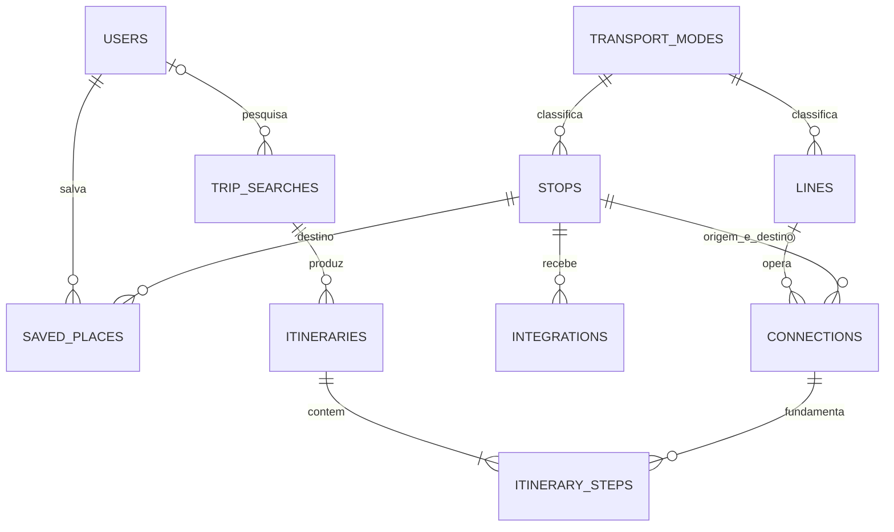

# Modelagem lógica do ELOMOB

O modelo separa a rede de transporte das informações particulares do usuário. Valores monetários são inteiros em centavos. Chaves estrangeiras impedem relações órfãs; toda chave estrangeira tem índice próprio, o que atende junções, consultas por origem, usuário e busca e as verificações feitas antes de uma exclusão.

## Tabelas do domínio

| Tabela | Dados e relações |
| --- | --- |
| users | Conta, senha com hash, e, em `jsonb`, modais preferidos e tipos de necessidade de acessibilidade (`accessibility_needs`) |
| transport_modes | Código único, nome e cor de cada modal |
| stops | Local, endereço, coordenadas, `location` geográfico gerado pelo PostGIS, modal principal, recursos de acessibilidade (`accessible`, `tactile_paving` e `visual_signs`) e disponibilidade demonstrativa de bicicletas |
| lines | Linha, modal, janela de funcionamento, frequência e tarifa |
| connections | Origem, destino, geometria `path` LineString, modal, linha opcional, duração, distância, tarifa de embarque própria quando não há linha e recursos de acessibilidade (`accessible`, `has_stairs`, `adapted`, `audible_signals` e `visual_signs`) |
| integrations | Troca de um modal para outro em um local, em um sentido, com tempo gasto, acessibilidade, integração tarifária (`fare_integrated`) e descrição; a carga registra os dois sentidos |
| saved_places | Nome dado pelo usuário a uma parada, com unicidade por usuário e nome |
| trip_searches | Origem, destino, saída pedida (`departure_at`, vazia quando a busca é para sair na hora), opções da busca em `filters` (modais e tipos de necessidade), usuário opcional, hash de sessão e data |
| itineraries | Critério e totais de uma opção calculada para uma busca |
| itinerary_steps | Sequência de conexões, valores calculados por etapa, `wait_minutes` e `transfer_minutes` incluídos na duração e `fare_integrated` quando a etapa embarcou por uma integração tarifária |

As tabelas adicionais de cache, filas, sessões e recuperação de senha são infraestrutura padrão do Laravel. O ambiente local guarda sessões e cache no Redis.

A migração aditiva habilita PostGIS e gera `stops.location` como `geography(Point,4326)` a partir das coordenadas. Índices GiST atendem consultas por proximidade em metros e geometrias de conexões. Triggers mantêm `connections.path` atualizado quando seus extremos ou as coordenadas das paradas mudam. A API usa `ST_DWithin`, `ST_Distance` e `ST_AsGeoJSON`. Os segmentos são esquemáticos e não representam ruas oficiais.

## Relações



Connections possui duas chaves para stops; trip_searches também possui origem e destino. Integrations possui duas chaves para transport_modes. O desenho resume essas relações; os scripts SQL apresentam cada coluna e chave.

## Acessibilidade

O usuário marca no perfil um ou mais tipos de necessidade. Cada tipo exige recursos da rede em todo o trajeto, e vários tipos somam as exigências. As colunas de paradas valem para as paradas em que a pessoa está: a origem, o destino, as paradas em que embarca ou desembarca e as que percorre a pé. Uma parada por onde ela só passa dentro do veículo não precisa delas.

| Tipo (`accessibility_needs`) | Paradas | Conexão | Integração |
| --- | --- | --- | --- |
| `wheelchair`: cadeira de rodas | `accessible` | `accessible`, `adapted` e sem `has_stairs` | acessível |
| `reduced_mobility`: mobilidade reduzida | — | sem `has_stairs` | acessível |
| `visual`: deficiência visual | `tactile_paving` | `audible_signals` | — |
| `hearing`: deficiência auditiva | `visual_signs` | `visual_signs` | — |

Nas paradas, `accessible` indica acesso sem degraus, `tactile_paving` o piso tátil e `visual_signs` o painel de informações. Nas conexões, `accessible` indica um trecho transitável em cadeira de rodas, `has_stairs` a presença de escada, `adapted` o veículo com elevador ou rampa, `audible_signals` o aviso sonoro e `visual_signs` o letreiro ou painel. Em um trecho a pé, `audible_signals` é o semáforo sonoro, `visual_signs` a sinalização visual, e `adapted` vale sempre verdadeiro, porque não há veículo. Os recursos novos começam como falsos, porque só existem depois de cadastrados.

## Integração tarifária

Quem troca de serviço em uma integração com `fare_integrated` paga só a diferença até a tarifa mais alta, e nada quando a nova tarifa é menor ou igual. Uma sequência de trocas integradas custa, assim, a maior tarifa entre os serviços usados. Chegar a pé ou trocar em uma integração sem tarifa integrada cobra a tarifa cheia. A etapa que embarcou pela integração guarda `fare_integrated` verdadeiro e, em `cost_cents`, só a diferença paga. A coluna começa como falsa, como os recursos de acessibilidade, porque só vale depois de cadastrada.

## Integridade

- Código de modal, código de linha e nome de parada são únicos.
- Uma conexão é única por origem, destino, modal e linha, então várias linhas podem atender o mesmo trecho. Conexões sem linha continuam únicas por trecho e modal, porque o PostgreSQL compara a linha vazia como igual (`NULLS NOT DISTINCT`).
- Um nome de favorito pode existir para usuários diferentes, mas não se repetir para a mesma conta.
- Não se repete um critério no mesmo conjunto de resultados nem uma posição no mesmo itinerário.
- Exclusão de usuário remove favoritos e desvincula as buscas da conta. Exclusão de busca remove seus itinerários e passos.
- Buscas sem conta (de visitantes ou de contas excluídas) são apagadas uma semana depois de criadas por uma limpeza diária (`model:prune`); só a sessão que fez a busca de visitante consegue abri-la de novo. As buscas de cada conta continuam no histórico.
- PostgreSQL verifica coordenadas válidas, duração e distância positivas nas conexões e origem diferente do destino.
- Frequências, durações, distâncias e posições são positivas; tarifas, custos, quantidades de bicicletas e vagas, trocas e tempos de integração nunca são negativos; a espera somada ao tempo de integração de um passo não ultrapassa a duração dele. O `unsigned` do Laravel não tem efeito no PostgreSQL, por isso essas regras são restrições CHECK.
- O critério de um itinerário e a rota preferida do usuário só aceitam os quatro critérios calculados pela aplicação.
- `users.accessibility_needs` é sempre uma lista e só aceita os quatro tipos de necessidade.
- Uma conexão com linha cobra a tarifa da linha e não guarda tarifa própria; só conexões sem linha (táxi, aplicativo, bicicleta e caminhada) têm `boarding_fare_cents`. Uma chave estrangeira composta para `lines (id, transport_mode_id)` mantém o modal da conexão igual ao da linha, e mudar o modal de uma linha atualiza suas conexões.
- As conexões referenciadas por passos não podem ser excluídas.

A preferência de modais, os tipos de necessidade e as opções de cada busca são pequenos documentos em `jsonb`, o tipo JSON binário do PostgreSQL, validados pela aplicação. O que define o resultado de uma busca fica em colunas: origem, destino e saída pedida, em UTC como as demais datas. As entidades da rede permanecem relacionais.

## Aplicar os scripts

Em um banco PostgreSQL vazio, a equipe pode executar:

```bash
psql -h localhost -U elomob -d elomob -f database/sql/01_schema.sql
psql -h localhost -U elomob -d elomob -f database/sql/02_seed.sql
```

O primeiro script também registra as migrations aplicadas. O segundo ajusta as sequências de IDs após inserir os dados. Não execute esses scripts sobre um banco já migrado. Para a rotina de desenvolvimento, use `php artisan migrate --seed`.

A carga tem 17 paradas, 7 linhas (entre elas a Linha Sul do metrô, a 061 pela Via Mangue e o BRT da Caxangá), 52 conexões e 6 integrações. Os recursos de acessibilidade variam de propósito: a Estação Recife tem degraus na entrada e escada até a plataforma da Linha Centro, cujos trens não têm painel; a travessia dela até o Recife Antigo não tem semáforo sonoro; as linhas 042 e 081 não têm letreiro; a 033 não tem elevador; o trecho a pé entre a Estação Joana Bezerra e Afogados não serve para cadeira de rodas; e o Terminal Cais de Santa Rita não tem piso tátil. Com isso, cada tipo de necessidade muda o trajeto de Boa Viagem ao Recife Antigo.

Coordenadas, conexões, tarifas, horários e recursos de acessibilidade da carga são dados de demonstração e precisam ser substituídos por fontes validadas antes de qualquer uso público.
