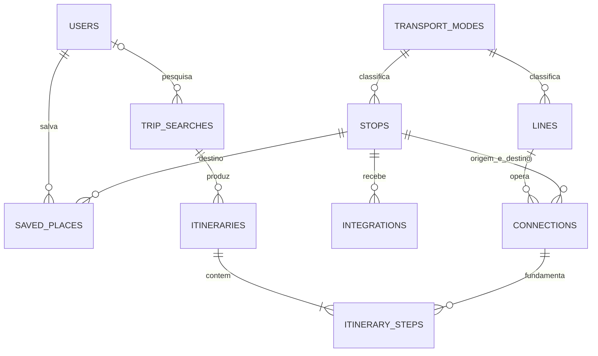

# Modelagem lógica do ELOMOB

O modelo separa a rede de transporte das informações particulares do usuário. Valores monetários são inteiros em centavos. Chaves estrangeiras impedem relações órfãs; toda chave estrangeira tem índice próprio, o que atende junções, consultas por origem, usuário e busca e as verificações feitas antes de uma exclusão.

## Tabelas do domínio

| Tabela | Dados e relações |
| --- | --- |
| users | Conta, senha com hash, modais preferidos em JSON e critérios de acessibilidade |
| transport_modes | Código único, nome e cor de cada modal |
| stops | Local, endereço, coordenadas, `location` geográfico gerado pelo PostGIS, modal principal e disponibilidade demonstrativa de bicicletas |
| lines | Linha, modal, janela de funcionamento, frequência e tarifa |
| connections | Origem, destino, geometria `path` LineString, modal, linha opcional, duração, distância, tarifa de embarque e acessibilidade |
| integrations | Local de troca entre dois modais, tempo e descrição |
| saved_places | Nome dado pelo usuário a uma parada, com unicidade por usuário e nome |
| trip_searches | Origem, destino, filtros, usuário opcional, hash de sessão e data |
| itineraries | Critério e totais de uma opção calculada para uma busca |
| itinerary_steps | Sequência de conexões, valores calculados por etapa e `wait_minutes` incluído na duração |

As tabelas adicionais de cache, filas, sessões e recuperação de senha são infraestrutura padrão do Laravel. O ambiente local usa sessões em arquivos e cache no Redis.

A migração aditiva habilita PostGIS e gera `stops.location` como `geography(Point,4326)` a partir das coordenadas. Índices GiST atendem consultas por proximidade em metros e geometrias de conexões. Triggers mantêm `connections.path` atualizado quando seus extremos ou as coordenadas das paradas mudam. A API usa `ST_DWithin`, `ST_Distance` e `ST_AsGeoJSON`. Os segmentos são esquemáticos e não representam ruas oficiais.

## Relações



Connections possui duas chaves para stops; trip_searches também possui origem e destino. Integrations possui duas chaves para transport_modes. O desenho resume essas relações; os scripts SQL apresentam cada coluna e chave.

## Integridade

- Código de modal, código de linha e nome de parada são únicos.
- Um nome de favorito pode existir para usuários diferentes, mas não se repetir para a mesma conta.
- Não se repete um critério no mesmo conjunto de resultados nem uma posição no mesmo itinerário.
- Exclusão de usuário remove favoritos e preserva buscas desvinculadas da conta. Exclusão de busca remove seus itinerários e passos.
- PostgreSQL verifica coordenadas válidas, duração e distância positivas nas conexões e origem diferente do destino.
- Frequências, durações, distâncias e posições são positivas; tarifas, custos, quantidades de bicicletas e vagas, trocas e tempos de integração nunca são negativos; a espera de um passo não ultrapassa a duração dele. O `unsigned` do Laravel não tem efeito no PostgreSQL, por isso essas regras são restrições CHECK.
- O critério de um itinerário e a rota preferida do usuário só aceitam os quatro critérios calculados pela aplicação.
- As conexões referenciadas por passos não podem ser excluídas.

A preferência de modais é uma lista pequena em JSON, validada pela aplicação. As entidades da rede permanecem relacionais.

## Aplicar os scripts

Em um banco PostgreSQL vazio, a equipe pode executar:

```bash
psql -h localhost -U elomob -d elomob -f database/sql/01_schema.sql
psql -h localhost -U elomob -d elomob -f database/sql/02_seed.sql
```

O primeiro script também registra as migrations aplicadas. O segundo ajusta as sequências de IDs após inserir os dados. Não execute esses scripts sobre um banco já migrado. Para a rotina de desenvolvimento, use `php artisan migrate --seed`.

Coordenadas, conexões, tarifas e horários da carga são dados de demonstração e precisam ser substituídos por fontes validadas antes de qualquer uso público.
